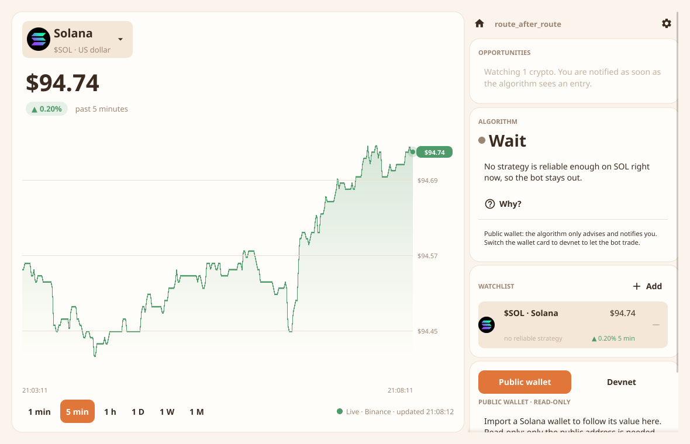
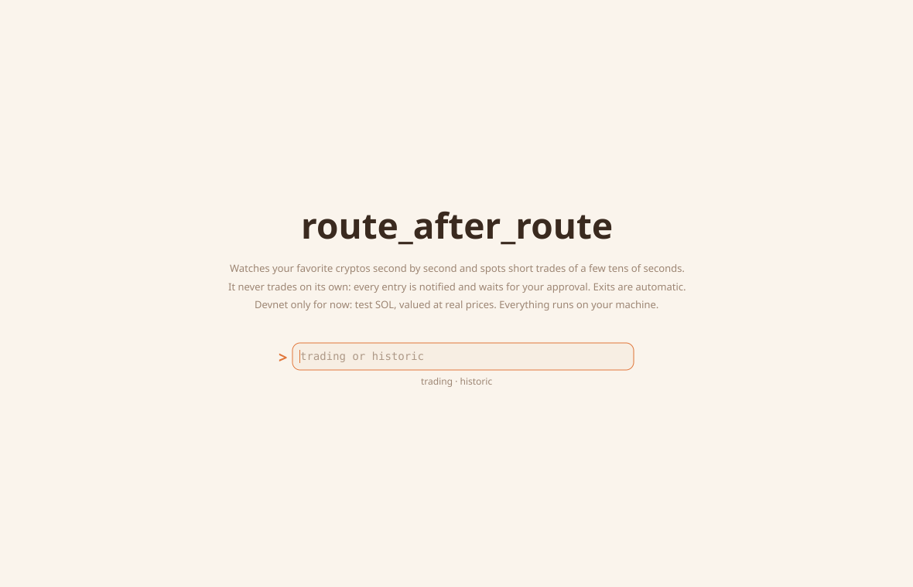
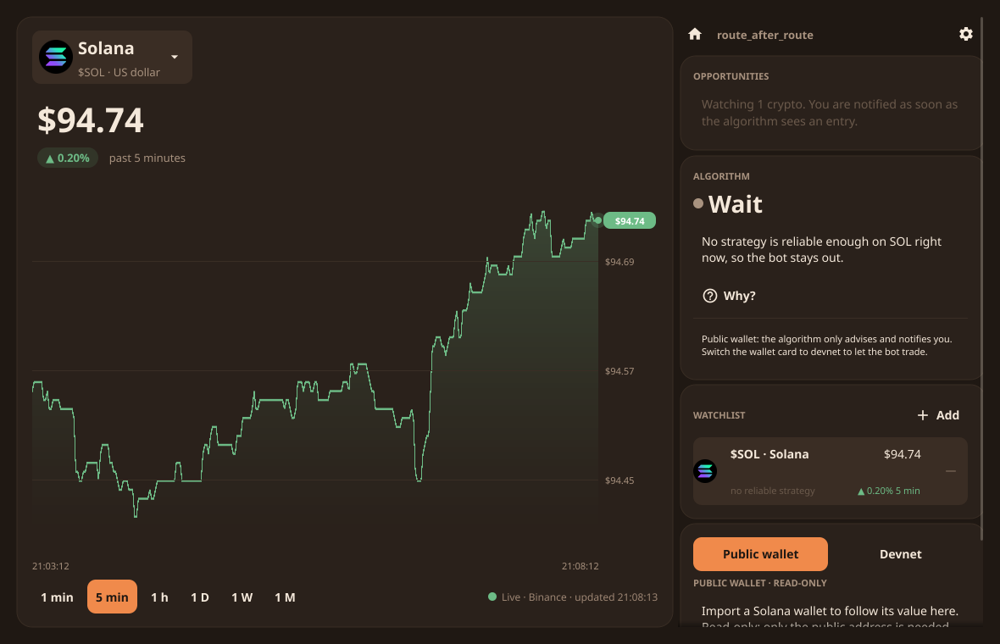

# route_after_route

A decision-making algorithm for public markets.

You give it your situation: capital, available time, skills and risk tolerance. Then you pick one or more public markets. It evaluates the available strategies, ranks them, and returns an ordered list of actions. Each action comes with its score and the numbers behind it.

**It proposes; you approve every entry.** The desktop app watches your favorite cryptos second by second, for trades lasting a few tens of seconds. When the algorithm sees an entry it notifies you, and the bot only takes it if you accept. For now it trades only on a **devnet ledger**: test SOL, valued at real prices. It never places a real order. Nothing is centralized: everything runs on your machine.

It comes in two forms:

- **a desktop app** that watches your favorite cryptos in real time on 1-second candles. It shows the algorithm's advice in plain words and notifies every opportunity. It lets a bot take the entries you approve on devnet, and follows your Solana wallet;
- **a command-line tool** (`rar`) that runs one decision cycle at a time, which suits scripts and scheduled jobs.



## How it works

Each run is one decision cycle:

1. **Profile.** Your situation is read and validated strictly. Your risk tolerance sets the maximum drawdown you accept and a stop-loss per position.
2. **Markets.** The markets you selected are loaded. The ones your profile can't access are filtered out, for example because your capital is too low or a required skill is missing.
3. **Strategies.** Each strategy reads the price history and gives an opinion between -1 (short) and +1 (long). It does not decide anything.
4. **Evaluation.** Every (market, strategy) pair is replayed on historical data. The replay is walk-forward and counts fees and slippage. Orders are filled at the next bar's open. Delisted symbols stay in the replay. The pair is scored on its out-of-sample results.
5. **Arbitration.** The algorithm drops invalid or too-risky candidates, ranks the rest by score and splits your capital between the best ones.
6. **Output.** It prints an ordered list of actions and the concrete orders to carry out (open, hold, close), with every intermediate value.
7. **Loop.** Your portfolio is saved locally. On the next cycle, its value becomes your new capital, and positions are closed on stop-loss, deselection or signal reversal.

See [docs/ARCHITECTURE.md](docs/ARCHITECTURE.md) for the contracts of each layer.

## Installation

### Download (no setup)

Download the file for your system from the [latest release](https://github.com/IlyasFounas/route_after_route/releases/latest), then run it:

| System | Desktop app | Command line |
|---|---|---|
| Linux | `route_after_route-linux-amd64.tar.xz`: extract it and run `usr/local/bin/rar-desktop`, or `sudo make install` to add it to your applications menu | `rar-linux-amd64` |
| macOS | `route_after_route-macos-arm64.zip` (Apple Silicon) or `-amd64.zip` (Intel): unzip it and open `route_after_route.app` | `rar-darwin-arm64` / `rar-darwin-amd64` |
| Windows | `route_after_route-windows-amd64.zip`: unzip it and run `route_after_route.exe` | `rar-windows-amd64.exe` |

The executables are **not signed** yet:

- **macOS** blocks the first launch. Right-click the app, choose *Open*, then confirm.
- **Windows** SmartScreen shows a warning. Click *More info*, then *Run anyway*.

### Build from source

Requires [Go](https://go.dev/dl/) 1.25 or later.

```sh
git clone https://github.com/IlyasFounas/route_after_route.git
cd route_after_route
go build -o rar ./cmd/rar                 # command line: pure Go, no other dependency
go build -o rar-desktop ./cmd/rar-desktop # desktop app: needs a C compiler and graphics headers
```

The desktop app uses [Fyne](https://fyne.io), which needs CGO:

- **Linux** (Debian/Ubuntu): `sudo apt install gcc libgl1-mesa-dev xorg-dev libwayland-dev libxkbcommon-dev`.
- **macOS**: install the Xcode command line tools with `xcode-select --install`.
- **Windows**: install a GCC toolchain such as [MSYS2](https://www.msys2.org/) MinGW-w64.

The command line tool needs none of this.

## Desktop app

The app is made to be glanced at: pick your favorite cryptos, and answer the opportunities it notifies. It has three screens.



### Home: one prompt

The app opens on its name, three lines on how it works and a single prompt. Type a command and press Enter:

| Command | Opens |
|---|---|
| `trading` | the algorithm, live, on all your cryptos |
| `historic` | every closed trade, with what it gained or lost |

The start of a word is enough (`t`, `hist`), and the line under the prompt tells what it will open. **Escape**, or the home icon, brings the prompt back. The algorithm keeps running whatever the screen, and opportunities are still notified.

### Trading

- **Watch several cryptos at once.** Add up to 10 favorites to the **watchlist**: every crypto traded against the dollar on Binance is available.
  - Each crypto shows its **logo** and its ticker as on social networks, `$SOL`.
  - Search by name (`Solana`), by ticker (`SOL`) or by `$` ticker (`$SOL`).
  - Each favorite gets its own real-time feed and its own strategy selection, all running in parallel.
  - The watchlist shows each one's price, its change over 5 minutes and what the bot is doing with it.
  - Click a favorite to show it on the chart.
- **Watch the price second by second.** The algorithm works on **1-second candles**, because trades last a few tens of seconds.
  - The chart shows the last minute, the last 5 minutes or the last hour, from those candles.
  - It also shows the last day, week or month, from coarser candles.
  - The curve is green when it rose over the period, coral when it fell. Hover it to read the price at any second. The bot's purchases and sales are marked on it.
- **Read the advice** in one word: *Buy*, *Hold*, *Sell* or *Wait*, with a one-sentence explanation. **Why?** opens the full reasoning: the strategy in charge, how it would have done on the past, what it reads right now, the strategies set aside and the recent bot activity.
- **Answer the opportunities.** When the algorithm wants to enter a position, it does not: it **notifies you**.
  - The *Opportunities* card shows the crypto, the price, the amount and a countdown (10 seconds by default), with **Accept** and **Ignore**. The tray menu also offers *Accept*.
  - Without an answer, the opportunity expires.
  - An ignored or expired opportunity is not proposed again until its signal changes, so you are not flooded.
- **Exits are automatic**: stop-loss, a maximum holding time (60 seconds by default) and signal reversal. A position never waits for you to close.
- **Choose the wallet** at the top of the wallet card:
  - **Public wallet**: paste the **public address** of a Solana wallet (Phantom, Solflare, Backpack…) to follow its value. The app values SOL and the known tokens (USDC, USDT, EURC, JUP, BONK…) in dollars.
    - It is read-only: never paste a secret phrase or a private key, the app does not need one.
    - In this mode the bot never trades: the algorithm only advises and notifies.
  - **Devnet**: the app generates a dedicated Solana **devnet** wallet. Devnet SOL is test money with no value.
    - **Airdrop 1 SOL** asks the devnet faucet for test SOL. It is rate-limited: if it refuses, request some on [faucet.solana.com](https://faucet.solana.com) with the address shown.
    - **Sync ledger** funds the bot's **devnet ledger** with the wallet's value, counting devnet SOL at the real SOL price.
    - Approved entries are executed in that ledger at the real Binance price. No devnet exchange has real liquidity, so there is no on-chain swap yet.
- **Allow the bot to trade** with the switch, in devnet only. It is **off by default**. Even when it is on, every entry still waits for your approval. Turning it off stops everything immediately, stop-loss included.
- **Settings** (gear icon): your risk tolerance, the approval window, the maximum holding time, and optional Solana mainnet and devnet RPC endpoints.

### Historic

Everything the bot gained or lost, in devnet or in the demo:

- **The summary**: number of trades, how many won and lost, net result, fees, best and worst trade.
- **Every closed trade**, newest first:
  - crypto and direction;
  - gain or loss, in dollars and in percent;
  - entry and exit time, and holding time;
  - entry and exit price;
  - amount and fees;
  - why it closed.

The *History* card of the trading screen shows the same summary with the last three trades; **See all** opens this screen.

Results are **net of trading costs**: the Binance fee plus the configured slippage, on both sides, as in the backtest. The history is kept in the ledger file: it survives restarts and *Sync ledger*.

### In the background

**Closing the window does not stop the algorithm.** It keeps watching from the system-tray icon and notifies every opportunity; the tray menu lets you accept them. Use *Quit* in the tray menu to stop it: the ledger is saved on exit.

The theme is warm and light, with a warm dark variant when your system uses dark mode.



### Files

On first launch, the app creates its files in your user config directory:

- `~/.config/route_after_route/` on Linux;
- `~/Library/Application Support/route_after_route/` on macOS;
- `%AppData%\route_after_route\` on Windows.

| File | Content |
|---|---|
| `settings.json` | your choices in the app: favorites, shown crypto, chart period, bot permission, wallet mode and address, ledger capital, approval window, max hold |
| `profile.json` | your risk tolerance, also editable from the settings |
| `config.json` | the strategies, backtest settings and policy used by the algorithm (advanced) |
| `devnet-wallet.json` | the devnet test wallet's key pair, in the Solana CLI format (readable only by you) |
| `devnet-ledger.json` | the bot's devnet ledger and the history of its closed trades, saved after every order |
| `logos/` | the crypto logos, downloaded once from Binance's CDN (display only; without them, letter badges are shown) |
| `demo/` | an offline replay of synthetic markets, used by `rar-desktop --demo` |

Command-line options, for advanced use:

- `--pair BTCUSDT` shows another crypto at launch, and adds it to the watchlist;
- `--demo` replays the synthetic markets instead of live prices, without network; its ledger starts from the profile's budget;
- `--config c.json` uses the markets of a config file as is;
- `--profile p.json` and `--state s.json` use other files.

### How it runs in real time

- **Every price update** refreshes the forming candle, marks the ledger to market and checks the **stop-loss** and the **max hold**.
- **Every closed candle**, that is every second, recomputes the signals of the selected strategies.
  - Positions are held or closed automatically.
  - A new entry becomes an **opportunity** that waits for your approval.
  - Signals are never computed on a candle that is still forming, because that is not what the backtest evaluated.
- **Every 5 minutes** the full evaluation runs again (walk-forward backtests and arbitration) on the last 2 hours of candles kept in memory. It never opens a position by itself either.
- **After a lost connection**, the app reconnects automatically and downloads the candles it missed.
- **After a stop-loss or a max-hold exit**, the position is not reopened in the same direction until its signal has gone flat or reversed.

While the bot is not allowed to trade, the algorithm keeps evaluating, advising and notifying opportunities, but the ledger does not change at all.

**About fees.** At this horizon, fees dominate. Binance's spot fee plus the configured slippage cost about 0.3 % per round trip. On 1-second candles, the two strategies of the catalogue do not beat that: the watchlist then says *no reliable strategy*, and no opportunity is raised. The algorithm has to look for moves larger than its costs.

## Command-line usage

1. **Fill in your profile** in [`examples/profile.json`](examples/profile.json), or a copy of it.
2. **Select the markets to analyze** in the config file, such as [`examples/config.json`](examples/config.json).
3. **Run the algorithm:**

   ```sh
   # Offline demo on deterministic synthetic data
   ./rar run --profile examples/profile.json --config examples/config.json --dry-run

   # Real data: Binance spot public API, no key needed
   ./rar run --profile examples/profile.json --config examples/config.binance.json
   ```

4. **Read the output.** Each line gives a market, a strategy, a suggested allocation and the breakdown of the calculation.

| Command | What it does |
|---|---|
| `rar run` | One full cycle: evaluate, arbitrate, print actions and orders, update `state.json` |
| `rar backtest` | Score every (market, strategy) pair, without arbitration or state |
| `rar markets` | List the selected markets and whether your profile can access them |
| `rar strategies` | Show the declaration of each configured strategy |

Common flags:

- `--format json` gives machine-readable output.
- `--state` chooses the state file.
- `--force` ignores the re-evaluation interval.
- `--dry-run` doesn't write the state file.

`rar run` is meant to be scheduled, with cron or a systemd timer. It does nothing until `reevaluate_every` has elapsed since the last cycle.

### Profile

The schema is fixed. Unknown, missing or out-of-range fields are rejected.

```json
{
  "capital": 1000000,
  "hours_per_week": 4,
  "skills": ["technical_analysis", "statistics"],
  "risk_tolerance": 5
}
```

- `capital` is in **minor units** (cents): `1000000` means 10,000.00.
- `skills` must come from a closed set: `derivatives`, `fundamental_analysis`, `programming`, `statistics`, `technical_analysis`.
- `risk_tolerance` is an integer from 1 to 10. It sets two limits:
  - the maximum accepted drawdown, equal to 5 % × tolerance;
  - the stop-loss, equal to half that drawdown.

### Configuration

Fields left out take the default values shown below.

```jsonc
{
  "markets": [                                     // your selection (required)
    { "type": "csvfile", "options": { "path": "../testdata/trend" } },
    { "type": "binance", "options": { "symbols": ["BTCUSDT"], "interval": "1d" } }  // 1s, 1m, 5m, 15m, 1h, 4h, 1d, 1w
  ],
  "strategies": [                                  // default: the whole catalogue
    { "id": "sma_cross" },
    { "id": "sma_cross", "name": "sma_fast", "params": { "fast": 5, "slow": 20 } }
  ],
  "period":   { "lookback_days": 730 },            // or { "lookback": "2h" }, or { "from": "2020-01-01", "to": "2022-09-27" }
  "backtest": { "slippage_bps": 5, "position_step": 0.25, "train_bars": 250, "test_bars": 60 },
  "policy":   { "max_active": 3, "rule": "capped", "cap": 0.5, "min_score": 0 },
  "reevaluate_every": "24h"
}
```

Relative paths are resolved from the config file's directory.

## Output

The output is deliberately traceable. For every suggested action you can trace back to the signal and the intermediate values that produced it. Every rejected candidate and every filtered-out market is listed with its reason. No decision is opaque.

This excerpt comes from the offline demo:

```
ACTIONS
  #  MARKET      STRATEGY       SCORE   WEIGHT  ALLOCATION
  1  demo-range  zscore_revert  2.0601  50.0%   5000.00

  [1] demo-range / zscore_revert — trace:
      max_drawdown             0.0409208
      mean_return              0.000557214
      sharpe                   2.0601
      trades                   311
      ...
    RANGE  signal=+0.140 exposure=+0.25 long  alloc=1250.00 price=98.8743  {mean=101.4 stdev=2.077 z=-1.21}

ORDERS
  OPEN  long  demo-range/RANGE  zscore_revert  1250.00  @98.8743    rank 1, signal +0.140, exposure +0.25

REJECTED CANDIDATES
  demo-trend / sma_cross (score 0.6052): max drawdown 30.3% exceeds risk limit 25.0%
  ...
```

## Make it yours

The algorithm is meant to be rewritten. Add your own strategies, plug in another market, change what the scoring maximizes, swap the allocation rule: nothing here is meant to be used as-is. The layers are kept separate precisely so you can replace one without touching the rest. A test (`internal/archtest`) fails if a layer starts depending on something it shouldn't.

| To change… | Look at |
|---|---|
| Add a strategy | [`internal/strategy/`](internal/strategy/): implement `Strategy` (`Spec()` + `Signal()`) and register it in the catalogue |
| Plug in a market | [`internal/market/`](internal/market/): implement `Market` (`Descriptor()` + `Bars()`), call `market.Register` in `init()`, and import it in [`cmd/rar`](cmd/rar/main.go) and [`cmd/rar-desktop`](cmd/rar-desktop/main.go). For real-time prices, also implement the optional `Streamer` interface. See `csvfile` and `binance` for examples. |
| Change the live behaviour | [`internal/live/`](internal/live/engine.go) |
| Change the interface or the theme | [`internal/gui/`](internal/gui/) |
| Read another kind of wallet | [`internal/wallet/`](internal/wallet/solana.go) |
| Change what the score maximizes | [`internal/eval/`](internal/eval/eval.go) |
| Swap the allocation rule | [`internal/arbiter/`](internal/arbiter/arbiter.go) |
| Change exit conditions | [`internal/loop/`](internal/loop/loop.go) |

Before proposing a change, run the checks:

```sh
go vet ./... && go test ./...                     # unit tests, layer rules, golden report
go test ./internal/app -update                    # regenerate the golden report after an intended change
go test ./internal/profile -fuzz FuzzParse -fuzztime 30s
go run ./tools/gendata                            # regenerate the synthetic demo data (fixed seed)
```

To publish a release, push a tag (`git tag v0.2.0 && git push origin v0.2.0`). The [release workflow](.github/workflows/release.yml) builds the executables for every system and attaches them to the GitHub release.

If your version works better, open a pull request.

## Disclaimer

This tool produces suggestions, not guarantees. Backtested performance does not predict future results. Markets carry a risk of capital loss, including total loss. Review every output before acting on it, and only commit money you can afford to lose.

## License

(to be filled in)
